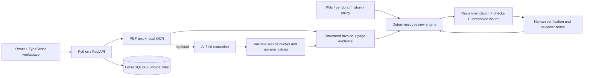

# Invoices — accounts-payable invoice review

A local application that turns invoice PDFs into an evidence-backed recommendation: **ready for approval**, **needs clarification**, **procurement review**, or **hold for investigation**. There is no login and no hosted service. The frontend uses React, TypeScript, and Vite (Node.js); the backend uses Python and FastAPI.

## Run

Prerequisites: **Python 3.11+**, **Node.js 20.19+ or 22.12+**, and npm. The first start downloads dependencies, including local OCR models.

```bash
git clone https://github.com/sudharsan319/tresata-invoice-review.git
cd tresata-invoice-review
./run.sh
```

Open **http://127.0.0.1:8000**. The launcher installs dependencies if necessary, builds the TypeScript frontend, and serves the whole application from the Python backend. The built-in demo works without an API key. Press **Ctrl+C** to stop.

Use the sun/moon button in the top bar to switch between light and dark themes. On first visit, the app follows the system preference; later choices are saved in this browser.

For frontend and backend development with hot reload:

```bash
./run.sh --dev
```

Open **http://127.0.0.1:5173**. Vite proxies `/api` to the backend at port 8000. API documentation is at **http://127.0.0.1:8000/docs**.

If Python reports that `venv` or `ensurepip` is missing on Ubuntu/Debian, install the matching `python3-venv` system package first. All installed application dependencies are isolated in `.venv/` and `frontend/node_modules/`.

## Try the complete workflow

1. Select **Try 13 sample invoices** in an empty workspace. The PDFs and supporting records are synthetic and go through the real extraction/checking pipeline.
2. Open an invoice to inspect its recommendation, individual checks, PO commitment balance, and source excerpts. Expand each check's sources to inspect the evidence.
3. Use **Extracted fields → Verify / correct** to compare with the original PDF, fix fields or item lines, and save a reason. All dependent recommendations are recomputed.
4. Record a reviewer note, or export the summary CSV / full evidence JSON. Recording a note does not send a message, approve an invoice in an ERP, or make a payment.
5. Upload your own documents by category. Files can arrive in any order. A structured PO or vendor-master import reruns reviews immediately; a PDF/image PO reruns reviews after its extracted draft is confirmed.

Uploads now open a **live processing view**: receive → read pages/OCR → extract → match records → verify → recommend. It shows real backend events, the model used for each AI call, elapsed provider wait time, each actual check with its evidence, and the final recommendation. Skipped AI calls and reused item comparisons are identified. There is no simulated percentage or approval animation. Select a file to follow it within a batch, then choose **Open invoice review** when processing completes.

New invoices retain an **Upload processing timeline** in **Decision & checks**. This is an upload-time snapshot; current checks reflect later corrections and reference changes. Existing invoices have no retroactive upload timeline. Reloading the browser reconnects to an active upload on the same server. Live jobs are held in memory (one upload at a time; latest 10 retained); server restarts discard live progress, while completed document traces remain in SQLite. The UI uses `POST /api/uploads` and polls `GET /api/uploads/{id}` every 700 ms, independently of the workspace processing lock. The original synchronous `POST /api/documents` remains supported.

Use **Policies** at the top right to open the policy menu. It lists all six active settings with their current values and explanations, the active profile and source, saved policy documents, pending AI policy drafts, and standard verification controls. **Edit active policy** opens the existing policy editor. Saved sources and unapproved drafts are identified separately from the active policy.

The sample-document ZIP and JSON templates can be downloaded from the interface. No client or personal financial data is included.

For physical files on disk, see [sample-data/README.md](sample-data/README.md). That extended pack contains **31 invoice PDFs and two alternative PO PDFs**, including varied layouts, scans, financial exceptions, and documented parser limitations. It includes its own supporting JSON files, expected-results manifest, and ZIP. Upload it into an empty workspace separately from the built-in 13-example demo.

### Synthetic cases

| PDF | Expected route | Reason |
| --- | --- | --- |
| 01-ready | Ready | Verified vendor; valid PO; arithmetic and prior commitment reconcile |
| 02-within-tolerance | Ready | 1% unit-price difference inside the explicit demo policy |
| 03-duplicate | Hold | Vendor + invoice number appears in history |
| 04-blocked-vendor | Hold | Vendor master marks the supplier blocked |
| 05-bank-changed | Hold | Invoice account differs from approved master |
| 06-missing-po | Clarification | Candidate POs offered, with no automatic match |
| 07-over-po-balance | Procurement | Amount and quantities exceed remaining order |
| 08-rate-mismatch | Procurement | Invoice unit price exceeds permitted tolerance |
| 09-missing-number | Clarification | Required invoice identifier is absent |
| 10-tax-discrepancy | Clarification | Subtotal + tax does not equal gross total |
| 11-partial-invoice | Ready | Prior and current partial invoices remain within PO capacity |
| 12-batch-capacity | Procurement | Earlier ready invoices in this batch consume remaining capacity |
| 13-scanned-invoice | Clarification | Local OCR extracts fields; a human must confirm the scan |

With the unmodified demo data, the queue contains **3 ready, 4 clarification, 3 procurement, and 3 held** recommendations. Sample dates are generated when the examples are loaded, avoiding stale fixtures.

## Input documents

**Invoices:** PDF only. Native text is extracted with PyMuPDF. Pages with little readable text are rendered and processed by local RapidOCR/ONNX models. Original PDFs and per-field evidence are retained. Files are limited to 20 MB and 30 PDF pages; at most 25 files per request and 120 documents per workspace.

**Supporting records:** JSON, CSV, or XLSX; PO PDFs and images are also supported through the review flow, and labelled individual-vendor PDFs are supported. JSON is the clearest format for nested item lines. CSV/XLSX `items` cells can contain a JSON array, and `aliases` can contain either a JSON array or semicolon-separated names. Spreadsheet bank accounts and identifiers with leading zeroes must be stored as text.

### Vendor master

```json
[
  {
    "vendor_id": "V001",
    "name": "Example Supplier",
    "status": "active",
    "tax_id": "SYNTHETIC-TAX-ID",
    "bank_account": "001234567890",
    "aliases": ["Example Supplier Pvt Ltd"]
  }
]
```

`active` and `approved` are accepted vendor statuses. Blocked/inactive/suspended vendors are held. Unknown approval status requires procurement review. Vendor IDs, tax IDs, names, and registered aliases must agree; a fuzzy name is not sufficient to approve a vendor.

### Purchase orders

```json
[
  {
    "po_number": "PO-001",
    "vendor_id": "V001",
    "currency": "INR",
    "amount": "10000.00",
    "amount_basis": "net",
    "status": "approved",
    "valid_from": "2026-01-01",
    "valid_to": "2026-12-31",
    "items": [
      {"description": "Support hours", "quantity": "10", "unit_price": "1000.00", "amount": "10000.00"}
    ]
  }
]
```

`amount_basis` is mandatory (`net` or `gross`). All comparisons use that basis; currencies are never silently converted. Amount-only POs can be uploaded, but absence of item detail routes to procurement. Reference IDs are normalized for matching; conflicting identities in new PO/vendor uploads are rejected rather than silently replacing master records. Remove the previous source document to replace its records.

POs can be uploaded as CSV, JSON, XLSX, readable PDF, scanned PDF, PNG, JPG, or WEBP. Structured records are validated and added immediately. PDFs and images are read with text extraction or OCR and, when enabled, the configured OpenRouter extraction/vision models. They become **pending PO drafts**, never active matching references on upload. Review the original beside the extracted PO, correct its number, vendor, currency, amount and net/gross basis, status, dates, and line items, then enter a review note and confirm. Activation records the reviewed fields, source document, and audit event and reruns invoice checks. The app does not infer approval from an unreadable scan.

### Previous invoices

```json
[
  {
    "invoice_number": "OLD-001",
    "vendor_id": "V001",
    "po_number": "PO-001",
    "currency": "INR",
    "subtotal": "2000.00",
    "total": "2360.00",
    "status": "paid",
    "items": [
      {"description": "Support hours", "quantity": "2", "unit_price": "1000.00", "amount": "2000.00"}
    ]
  }
]
```

Approved, paid, pending, submitted, and processing records consume PO capacity. Rejected/cancelled/void records do not. Unknown statuses require review. Item-level history is needed to verify cumulative item quantities. An empty JSON array (`[]`) explicitly declares a zero-record history register. Without a history source, the system reports that historical duplicate checks cannot be completed.

### Company policy

```json
{
  "name": "Company AP policy",
  "amount_tolerance_percent": "2",
  "amount_tolerance_absolute": "0",
  "unit_price_tolerance_percent": "0",
  "require_line_items": true,
  "check_bank_details": true,
  "max_invoice_age_days": 365
}
```

A built-in policy is visible until replaced. The policy can also be edited directly in the interface. Explicit `parameter: value` text/PDF policies import directly. With OpenRouter enabled, prose policies produce a source-backed draft that must be reviewed and activated in **Policies → AI settings**; without AI, unrecognized prose is rejected. The absolute tolerance is measured in each PO's currency; configure 0 when a uniform cross-currency amount would be inappropriate.

## Extraction and optional AI

The application works without an API key using local PDF extraction, layout reconstruction, explicit field labels, and local OCR. The local invoice parser handles labelled fields and item columns of description, quantity, unit price, and amount. It deliberately sends unfamiliar layouts or incomplete item extraction to human review.

Open **Policies → AI settings** to configure OpenRouter. Enter your key directly into the password field, choose task models, enable processing, and save. **Test saved key** calls OpenRouter's key-information endpoint and does not run a paid model. Settings take effect without restarting the server.

The budget defaults are:

| Task | Model ID |
| --- | --- |
| Invoice extraction | `mistralai/mistral-nemo` |
| Scanned-page vision | `google/gemma-3-12b-it` |
| Semantic item matching | `mistralai/mistral-small-24b-instruct-2501` |
| Policy interpretation | `mistralai/mistral-small-24b-instruct-2501` |
| On-demand reviewer brief | `mistralai/mistral-nemo` |

The model picker loads current supported models and token prices from OpenRouter. Each task can use a different model; the vision task needs an image-capable model. These are economical defaults, not a claim that they have been benchmarked for production financial accuracy. All five task routes have now been smoke-tested with live OpenRouter calls using synthetic documents after a key was configured. This verifies connectivity and a small set of sourced outputs, not production financial accuracy.

**What is sent:** invoice and document-based PO text; selected page images when vision is enabled; relevant invoice/PO item descriptions for non-exact matches; uploaded prose policy text; and existing check results when you explicitly request an AI brief. Uploaded files stay locally, while the selected text/images are processed through OpenRouter and its model providers. API keys never enter prompts, workspace JSON, exports, browser storage, or API responses. The backend stores UI-supplied configuration and the key in `data/ai-settings.json` with file mode 0600. This is local plaintext storage protected by filesystem permissions.

**What AI does:**

- Extracts invoice identifiers, amounts, and item rows despite different labels/layouts. For document-based POs, it proposes source-backed fields and item rows in a draft. Unsupported values are discarded; the PO requires human confirmation before matching. Model/local disagreement, scans, and vision transcriptions require human verification.
- Transcribes scanned or sideways pages using the chosen vision model, then extracts facts against that transcription. The original OCR text and original PDF are retained. Vision transcriptions are model-derived evidence that must be checked against the images.
- Compares non-exact invoice and PO item descriptions, explaining proposed equivalence. Quotes and indices are validated, explicit conflicting item IDs/numbers block equivalence, and a reviewer must confirm the proposed mapping. Python still checks prices, quantities, taxes, and remaining commitments. Confirmed mappings are used for cumulative quantities so paraphrasing cannot hide earlier consumption.
- Turns prose policy text into a proposed set of rules with source quotes and unresolved issues. The current policy stays active until a human edits/reviews and activates the draft.
- Generates an optional reviewer brief from existing check IDs. The brief is advisory and never changes the deterministic recommendation.

**Cost control and traceability:** item comparisons are cached while the underlying invoice/PO facts and selected matching model remain unchanged. Reviewer briefs run only on request. Vision page limits and output-token limits are configurable. The per-invoice AI panel shows tasks, actual model IDs, token usage, provider-reported cost when available, and failures. No automatic upgrade to a more expensive model occurs.

Existing invoices are not silently re-extracted. Use **Reprocess existing invoices** in **Policies → AI settings**, or **Re-extract with AI** inside one invoice. Background jobs show progress, preserve original extraction snapshots, and skip human-verified extractions. AI calls use your OpenRouter credits. Provider errors retain local extraction/checks and appear in the AI trace.

Environment configuration is also supported:

```bash
cp .env.example .env
# Set OPENROUTER_API_KEY and optionally the AI_*_MODEL variables.
./run.sh
```

UI settings override environment defaults. Existing compatible-provider `AI_BASE_URL`, `AI_API_KEY`, and `AI_MODEL` environment configuration remains supported. The UI always saves OpenRouter configuration. Restart after editing environment variables; UI settings themselves apply immediately.

## Architecture and financial controls



- **Document quality:** required identifiers, valid dates, readable pages, complete line items, and explicit currency. Ambiguous numerical dates such as `01/02/2026` require confirmation; use ISO dates.
- **Identity:** exact vendor ID/name/alias/tax-ID checks, approved-vendor status, and invoice-versus-master bank-account comparison.
- **Duplicates:** vendor-scoped normalized invoice number, historical file hashes when provided, and identical invoice hashes within the current workspace. Repeat uploads are retained and flagged.
- **PO matching:** explicit PO reference, vendor ownership, approval status, currency, and validity dates. Similar vendor-owned POs are suggestions; a human must supply/confirm the reference.
- **Amounts:** `Decimal` arithmetic, subtotal + tax reconciliation, quantity × rate calculations, line-total reconciliation, unit-price tolerance, and cumulative PO amount/quantity limits. Tolerance is `max(PO amount × percentage / 100, absolute amount)`.
- **Partial billing:** historical commitments are subtracted first. Ready invoices then reserve balance in stable upload order. Every mutation recomputes the queue; unresolved/held invoices do not reserve amounts. The interface exposes reservations and the invoice references involved.
- **Routing priority:** hold → procurement → clarification → ready. All individual issues remain visible, including issues below the highest-priority route.
- **Evidence:** original files, extraction snapshots, source excerpts, imported row evidence, correction reasons, and timestamped actions. JSON exports contain the full evidence and activity trail; CSV exports contain a compact review summary and protect against formula injection.

## Validation

```bash
PYTEST_DISABLE_PLUGIN_AUTOLOAD=1 .venv/bin/python -m pytest backend/tests -q
cd frontend
npm run build
```

The suite exercises 12 real PDF scenarios plus scanned-PDF OCR, mixed-currency rejection, tax arithmetic, historical and current-batch PO commitments, cumulative quantities, duplicate identity scope, changed bank details, protected PDFs, unsupported policies, CSV/XLSX/PO-PDF imports, source removal, correction audit trails, AI grounding/fallback, and API restrictions. See `VALIDATION.md` for the verified result.

## Practical boundaries

This is a local prototype with a single shared workspace. It performs **two-way invoice-to-PO review**, with human approval still required. It does not validate legal tax eligibility/rates, authenticate vendor-master records, check goods receipts, book journal entries, initiate payments, or assert fraud. Invoice math is reconciled to two decimal places; more specialized currency/rounding rules need configuration before production use.

Important sources of uncertainty remain visible: damaged scans, ambiguous item descriptions, missing amendments/PO records, missing historical quantities, and incomplete history. Source-grounded extraction can still misinterpret a document; reviewers must verify the recommendation against originals. Keeping master data and the history register complete is essential. Existing extraction snapshots are preserved; reprocessing is explicit when AI settings change.

Files and SQLite data live in `data/` by default; set `AP_DATA_DIR` to change the location. The launch command binds to `127.0.0.1`. This no-login design is intended for one local operator; shared deployment would require authentication, authorization, stronger storage controls, and operational limits. No deployment or hosting configuration is included.
