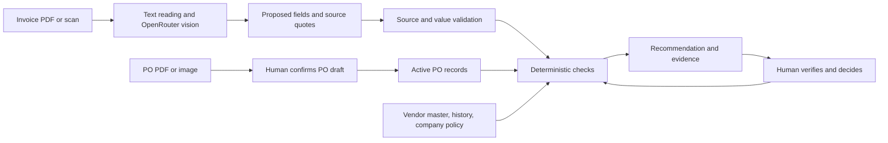

# Invoice and Purchase Order Review Written Brief

**Tresata take home assignment · 3 November 2026**

## 1. Problem and scope

Accounts payable (AP) reviewers receive invoices as readable PDFs and scans, then compare each one with a purchase order (PO), a vendor master, earlier invoices, and company policy. My problem is the time and uncertainty in making that comparison for **each incoming invoice**, especially when one PO is billed in several parts. A single invoice can have correct arithmetic and still be a duplicate, name a blocked vendor, use changed payment details, or push the cumulative order beyond its limit.

The work matters because a mistaken “ready” decision can move an unsupported bill toward payment, while a mistaken rejection delays a legitimate supplier. I have no measured workload from an AP team. As an **illustrative assumption**, 100 invoices per week at five minutes of cross-checking each would require about 8.3 reviewer hours weekly before resolving exceptions. The prototype aims to reduce routine comparison work while keeping the reviewer responsible for disputed facts and approval.

The prototype covers **company purchasing controls**, illustrated mainly with synthetic INR invoices and one scanned invoice showing `$`. It does not decide whether any country's tax rate is legally correct. Goods receipt, vendor onboarding, ERP posting, payment, and fraud findings are outside this scope. A rollout in India or another jurisdiction would need separately maintained local tax, invoice, currency, and retention rules.

## 2. Solution design

An operator uploads invoice PDFs and supporting PO PDFs/images or structured records. The system keeps the original files, extracts fields and item rows, compares them with approved vendor records and prior commitments, and returns a recommendation with individual checks and source excerpts. PO PDFs/images enter as **drafts**; a person reviews their number, vendor, amount basis, status, dates, and lines before they can affect invoice decisions.

AI helps read varied layouts and scanned pages, and proposes equivalence between differently worded invoice and PO items. It cannot approve a bill, invent a missing PO, or activate a PO draft. The backend checks quoted values against page text, uses decimal arithmetic for totals, quantity × price, tax reconciliation, and cumulative PO capacity, and flags ambiguous or missing facts. A reviewer verifies scans and semantic item matches, corrects fields with a reason, and makes the final decision. The four routes are **ready for approval**, **needs clarification**, **procurement review**, and **hold for investigation**; ready remains a recommendation.

I rejected a single LLM “approve/reject” call because amounts, policy tolerances, and prior commitments must be repeatable and auditable. Pure labels and OCR were also insufficient: the test scan split labels across columns and damaged item spacing. Fuzzy auto-matching to a similar PO would be unsafe when a reference is absent. Combining model-assisted reading with exact checks gives the model a useful task without making it the authority for financial decisions.

## 3. Prototype evidence, risks, and next questions

The local FastAPI/React prototype was run on **13 synthetic invoice scenarios** with supporting POs, vendor records, history, and policy. The current code produced the expected route in **13 of 13** scenarios in an isolated run. These are designed examples, not a measured accuracy rate on real company invoices.

| Test case | Observed route | What it exercises |
| --- | --- | --- |
| Standard invoice | Ready | All references and arithmetic agree |
| Within configured tolerance | Ready | Explicit price tolerance applies |
| Earlier invoice number reused | Hold | Duplicate against history |
| Blocked vendor | Hold | Vendor status overrides clean arithmetic |
| Changed bank account | Hold | Payment detail conflicts with vendor master |
| Missing PO reference | Clarification | Candidate cannot become an automatic match |
| PO amount/quantity exceeded | Procurement | Order limit is enforced |
| Unit price exceeds tolerance | Procurement | Line-level price check |
| Missing invoice number | Clarification | Required identifier is absent |
| Subtotal + tax differs from total | Clarification | Explicit tax arithmetic fails |
| First partial invoice | Ready | Earlier commitments are counted |
| Later invoice exceeds shared PO | Procurement | Batch reservation prevents overspending |
| Scanned invoice | Clarification | Extracted fields need visual verification |

A second six-invoice synthetic set tests split orders: 4 + 6 software seats fully use a 10-seat PO, while 3 + 3 delivery trips exceed a five-trip PO. In the OpenRouter run on `output.pdf`, vision supplied all three correctly named item rows; the totals reconcile, but missing PO reference, ambiguous `$`, unstated tax, old date, and absent approved-vendor record correctly keep the recommendation at **needs clarification**. The due date came from OCR fallback because the model did not give a usable supporting quote. The synthetic PO's USD, validity dates, and approval status are test assumptions, not facts proved by that invoice.

| Risk | Response in this prototype |
| --- | --- |
| Wrong extraction or model hallucination | Source quotes and numeric checks; unsupported vendor IDs/bank accounts rejected; scans remain for human review |
| Missing or outdated rules and reference data | Visible policy and uploaded master/history sources; incomplete history or missing PO triggers clarification |
| Confidential financial data | Local files and SQLite; selected text/images go to OpenRouter when enabled; only public or synthetic data used here |
| Incorrect business action or liability | No payment or ERP action; a person owns final approval and correction reasons are logged |

Before further investment, I would test public invoice/PO pairs with labelled ground truth, measure field and decision errors and reviewer time, and ask AP staff which exceptions need separate workflows. I would also check whether PO, vendor, and invoice-history records are complete enough for reliable matching.

## Appendix: What I added beyond AI

**Where AI helped.** I used an AI coding assistant during implementation and review, and OpenRouter models in the prototype for visual transcription, field extraction, and optional item-description comparison. Three short operational prompt excerpts show the boundaries given to the models:

1. “Preserve labels and literal identifiers, amounts, signs, currency, and dates. Put table rows on separate lines with columns separated by `|`.”
2. “Extract invoice facts only ... Do not make decisions, invent values, calculate tax, or choose a PO ... Every nonempty field and every item needs an exact source quote.”
3. “Extract a purchase order as a reviewable draft ... Do not infer approval, currency, amount basis, or missing values.”

**What I rejected or corrected.** The first local parse of `output.pdf` inferred zero tax merely because subtotal equalled total; I removed that inference. A model then treated an unlabeled address number as a vendor ID and “Pay Cheque to John Doe” as a bank account; I required field-role evidence. An OpenRouter vision call omitted a blank second page, so I changed validation to accept an omitted page only when its rendered image is actually blank. These errors were visible by comparing extracted values with the original PDF, not by trusting the model's wording.

**What came from me.** I designed the backend Architecture and front end and asked Codex to build a system. Apart from that, for testing different cases, I chose to test split billing rather than only isolated invoices, to leave missing PO and currency facts unresolved even when a synthetic PO fits numerically, and to require human confirmation before a parsed PO becomes active. I also kept source files, per-field evidence, review reasons, and the ability to rerun checks after a correction.

**What I can defend without AI.** For a PO, calculate the remaining authorized amount and item quantities after earlier committed invoices and confirmed current invoices. Use the PO's stated net/gross basis and decimal arithmetic. If an earlier scanned invoice may consume the same PO but has not been verified, hold the later capacity conclusion for clarification; do not silently treat that uncertain amount as zero.
